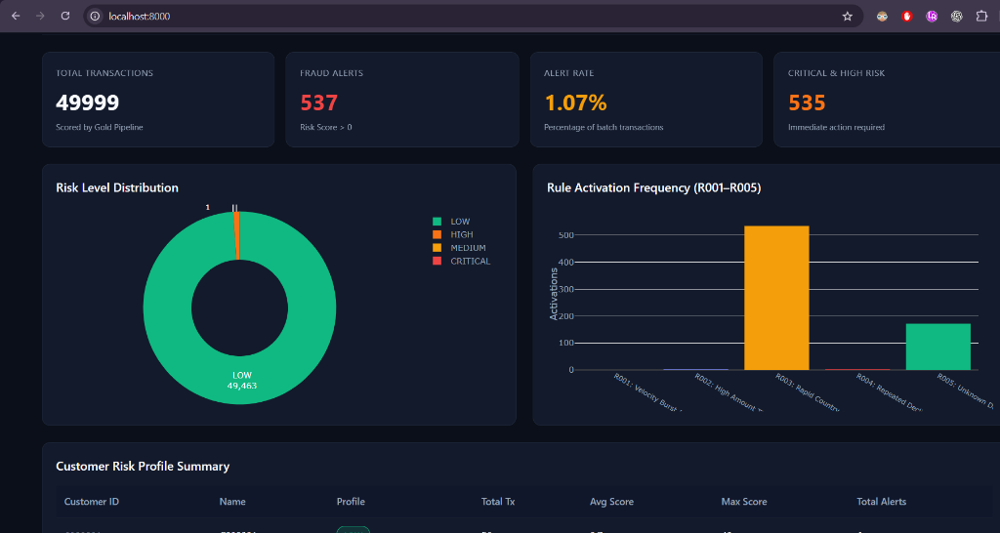

# 🛡️ Fraud Pattern Detector — V1.0


**Fraud Pattern Detector** es un sistema batch de ingeniería de datos desarrollado con **Scala 3** y **Apache Spark 3.5**, diseñado para la ingesta, validación de calidad de datos, evaluación de reglas heurísticas antifraude y clasificación de riesgo en transacciones financieras sintéticas.

El proyecto implementa una arquitectura **Medallion (Bronze ➔ Silver ➔ Gold)** con validación metrológica estricta y exportación a un **Cuadro de Mando Ejecutivo (Dashboard Web)** interactivo desacoplado de Spark.

---

## 📊 Vista Previa del Dashboard Ejecutivo



---

## 🏗️ Arquitectura del Sistema (Medallion Pattern)

```text
               +----------------------------------+
               | Generador Sintético Python       |
               | (mode: dev / full / controlled)  |
               +----------------------------------+
                                |
                                v
               +----------------------------------+
               | CSVs de Entrada (data/raw/)      |
               | customers / devices / txs        |
               +----------------------------------+
                                |
                                v
     =================== BRONZE LAYER ===================
     | Spark Ingestion with Strict Schemas              |
     | Metadata: batch_id, ingested_at_utc, row_number |
     ====================================================
                                |
                                v
     =================== SILVER LAYER ===================
     | Data Quality Engine (Validations Q001-Q016)      |
     | - Exact Dupes Deduplication (Q009A)              |
     | - Conflicting Dupes to Quarantine (Q009B)        |
     | - Known Device Resolution (known_device)         |
     ====================================================
           |                                       |
           v                                       v
   +---------------+                       +---------------+
   | Valid Silver  |                       | Cuarentena    |
   | Datasets      |                       | (rejections)  |
   +---------------+                       +---------------+
           |
           v
     ==================== GOLD LAYER ====================
     | Fraud Engine: Rule Evaluation (R001-R005)        |
     | Risk Scoring (0-100) & Levels (LOW..CRITICAL)   |
     | Dataset Publishing: scored_transactions & alerts |
     ====================================================
                                |
                                v
     ================ DASHBOARD EXPORTS =================
     | Exporter: summary_kpis, rule_stats, alerts JSONs |
     | Interface Web Interactiva (HTML5 + Plotly.js)    |
     ====================================================
```

---

## ⚡ Reglas Antifraude e Indicadores de Riesgo

El motor de reglas evalúa 5 heurísticas de comportamiento sospechoso sobre ventanas temporales deslizantes en Spark SQL:

| Regla | Nombre | Descripción | Ventana / Condición | Puntos |
|---|---|---|---|:---:|
| **R001** | *Velocity Burst* | Frecuencia inusual de transacciones aprobadas por cliente. | $\ge 5$ transacciones aprobadas en 10 min | **20** |
| **R002** | *High Amount* | Transacción aprobada que supera el umbral del perfil de riesgo. | LOW > 2.000€, MEDIUM > 1.500€, HIGH > 1.000€ | **30** |
| **R003** | *Rapid Country Change* | Cambio geográfico rápido entre transacciones aprobadas consecutivas. | `lag(1)` país $\neq$ actual en $\le 60$ min | **40** |
| **R004** | *Repeated Declines* | Patrón persistente de rechazos en ventana corta. | $\ge 3$ transacciones rechazadas en 15 min | **15** |
| **R005** | *Unknown Device Combo* | Transacción desde dispositivo no registrado combinada con otra regla. | `!known_device AND (R001 OR R002 OR R003 OR R004)` | **10** |

### Niveles de Riesgo
* **BAJO (`LOW`):** 0 – 19 puntos
* **MEDIO (`MEDIUM`):** 20 – 39 puntos
* **ALTO (`HIGH`):** 40 – 59 puntos
* **CRÍTICO (`CRITICAL`):** $\ge 60$ puntos

---

## 🛠️ Tecnologías Utilizadas

- **Procesamiento Distribuido:** Apache Spark 3.5.1 (Spark SQL, Window Functions)
- **Lenguaje Principal:** Scala 3.3.3 (sbt 2.0.9)
- **Generador Sintético:** Python 3.14 (Faker, PyYAML)
- **Formatos de Datos:** Parquet (Columnar Storage), CSV, JSON
- **Visualización:** HTML5, CSS3 Glassmorphism, JavaScript, Plotly.js
- **Testing:** ScalaTest 3.2.18 (100% éxito en 7 suites de prueba)

---

## 🚀 Guía Rápida de Instalación y Ejecución

### Requisitos Previos
- **Java JDK:** 17 o superior
- **sbt:** 2.0.9 o superior
- **Python:** 3.10 o superior (con `pip install faker pyyaml`)

---

### Paso 1: Generar Dataset Sintético Masivo
```bash
cd generator
python generate.py --mode full --seed 42 --output-dir ../data/raw
```
*Genera 50,004 transacciones en `data/raw/transactions.csv` con inyección de escenarios R001–R005 y defectos de calidad.*

---

### Paso 2: Ejecutar la Suite de Pruebas Unitarias
```bash
cd spark-pipeline
sbt "testOnly *"
```
*Verifica la compilación y pasa el 100% de las pruebas unitarias (Bronze, Silver, Quality, Fraud Engine, Exporter).*

---

### Paso 3: Procesar el Pipeline End-to-End en Spark
```bash
cd spark-pipeline
sbt run
```
*Ejecuta la ingesta Bronze, validación Silver/Cuarentena, evaluación Gold R001–R005 y exporta las métricas al Dashboard.*

---

### Paso 4: Abrir el Dashboard en el Navegador
Abre un servidor HTTP liviano en la carpeta `dashboard/`:
```bash
python -m http.server 8000 --directory dashboard
```

Visita en tu navegador:
👉 **[http://localhost:8000](http://localhost:8000)**

---

## 📁 Estructura del Repositorio

```text
fraud-pattern-detector/
├── docs/                        # Especificaciones técnicas, arquitectura y diagramas
│   └── images/                  # Imágenes y capturas de pantalla del proyecto
├── spark-pipeline/              # Proyecto Scala 3 + Apache Spark
│   ├── build.sbt                # Configuración de dependencias sbt
│   └── src/
│       ├── main/scala/frauddetector/
│       │   ├── config/          # AppConfig (auto-descubrimiento de dataset)
│       │   ├── engine/          # FraudRulesEngine (R001-R005, scoring)
│       │   ├── exporter/        # DashboardExporter (Métricas JSON)
│       │   ├── ingestion/       # BronzeIngestion, SilverPipeline, GoldPipeline
│       │   └── quality/         # QualityRules, DataQualityValidation
│       └── test/scala/          # Suite de pruebas unitarias ScalaTest
├── generator/                   # Generador sintético en Python
│   ├── generate.py              # CLI principal (--mode controlled/dev/full)
│   └── src/                     # Generadores de clientes, dispositivos y escenarios
├── data/                        # Datasets (Raw, Bronze, Silver, Gold, Sample)
│   └── sample/                  # Dataset fixture controlado para pruebas reproducibles
├── dashboard/                   # Aplicación Web estática interactiva
│   ├── index.html               # Cuadro de mando ejecutivo en Español
│   └── data/                    # JSONs exportados por Spark
├── .gitignore                   # Exclusiones de Git
└── README.md                    # Documentación principal
```

---

## 📜 Licencia

Este proyecto está bajo la Licencia MIT.
